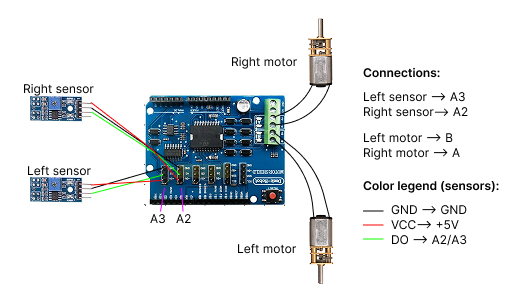

# Robot Wiring Reference

This is the instructor's reference drawing, not a complete ESP32 wiring or power schematic. The motor shield is illustrated; the exact driver IC marking is not legible enough to identify from this file.

| Connection | Drawing label | ESP32 mapping used by the library |
|---|---|---|
| Right motor | A | PWM 25, direction 19, brake 13 |
| Left motor | B | PWM 23, direction 18, brake 12 |
| Right line sensor | A2 | GPIO35 |
| Left line sensor | A3 | GPIO34 |

Motor A's right-side identity and forward movement have been physically confirmed. Sensor sides are taken from this drawing and still require a physical check. Sensor polarity and reliable black/white response remain uncalibrated.

Switch off USB and battery power before changing connections. The drawing does not show motor battery wiring; use the instructor-verified arrangement for the actual kit.

The drawing labels sensor VCC as +5 V. This does not establish that its DO output is safe for an ESP32. Identify the sensor module/output circuit and check the DO high voltage before connecting it to GPIO34/35. ESP32 GPIO is not 5 V tolerant; use a compatible supply/output or appropriate level shifting for the identified module. See [Espressif's GPIO voltage guidance](https://docs.espressif.com/projects/esp-faq/en/latest/hardware-related/hardware-design.html).

Original image: 510 × 302 pixels. The presentation retains the original wiring image and adds editable labels; no generated reconstruction of pins or wires is used. Obtain a higher-resolution original or an actual kit photograph if detailed connector labels are needed.
